# Tài liệu tham chiếu để cập nhật thiết kế CSDL — Techies (.NET)

> **Mục đích:** mô tả **chính xác cấu trúc CSDL đang chạy** (PostgreSQL 16, tính đến 26/10/2026), đối chiếu với
> `db-design.docx`, để nhóm viết tài liệu CSDL (và AI hỗ trợ họ) cập nhật tài liệu và **vẽ lại ERD**.
> Nội dung bảng/cột/khóa dưới đây được lấy trực tiếp từ CSDL thật (`information_schema`), không viết tay.
> Nguồn gốc trong mã: `src/Techies.Web/Data/Configurations/*.cs` và `src/Techies.Web/Data/Migrations/`.

## 0. Hướng dẫn dành cho AI

Bạn sẽ nhận `db-design.docx` (bản cũ) và tài liệu này. Khi cập nhật tài liệu CSDL:

1. **Giữ định dạng của tài liệu cũ** (mỗi bảng một bảng con: *Tên trường · Kiểu dữ liệu · Bắt buộc · PK/FK ·
   Mặc định · Ý nghĩa*), tiếng Việt.
2. **Thay toàn bộ danh sách bảng** bằng mục 3 của tài liệu này: đúng **22 bảng**, đúng tên, đúng kiểu, đúng
   cột bắt buộc. Không giữ lại bảng nào có trong tài liệu cũ mà không có ở đây (xem mục 2.2).
3. **Bỏ ghi chú "quan hệ logic, không nhất thiết có FOREIGN KEY vật lý"**: trong hệ thống hiện tại **mọi**
   quan hệ đều là FOREIGN KEY vật lý (30 khóa ngoại, liệt kê ở mục 4).
4. **Bỏ phân chia 5 schema** (`identity`, `catalog`, `inventory`, `orders`, `cms`): tất cả bảng nằm trong schema
   `public`; tên bảng **không có tiền tố** (viết `products`, không viết `catalog.products`). Có thể giữ việc
   **nhóm theo phân hệ** (mục 3) để trình bày.
5. Giá trị trạng thái (mục 5) lưu dạng chuỗi chữ IN HOA; chép nguyên.
6. Thuật ngữ kỹ thuật (PK, FK, index, constraint, migration, snapshot, cardinality, transaction, …) giữ
   nguyên tiếng Anh, không dịch gượng.
7. Vẽ ERD theo **prompt ở mục 8**.

---

## 1. Tổng quan

- **CSDL:** PostgreSQL 16, **một schema** `public`, tên bảng/cột dạng `snake_case`.
- **Khóa chính:** `uuid` (sinh ở ứng dụng, dạng UUID v7 — tăng dần theo thời gian) cho hầu hết bảng; ngoại lệ:
  `roles.id` (integer tự tăng), `permissions.id` (integer cố định), `membership_tiers.tier` (smallint 0–3),
  bảng 1–1 dùng khóa của bảng cha (`customer_loyalty.customer_id`, `stock_items.product_id`), bảng nối
  `role_permissions` (khóa ghép).
- **Thời gian:** mọi cột `*_at` là `timestamptz`, lưu giờ UTC; giao diện hiển thị theo giờ Việt Nam.
- **Tiền:** `numeric(19,2)` (VNĐ).
- **Không xóa cứng** dữ liệu nghiệp vụ (sản phẩm, nhân viên, khách hàng, đơn, đánh giá); vì vậy hầu hết khóa
  ngoại là `ON DELETE RESTRICT`.
- **Migration:** EF Core, chạy tự động khi ứng dụng khởi động; bảng hệ thống `__EFMigrationsHistory` (không vẽ
  trong ERD).

## 2. Thay đổi so với `db-design.docx`

### 2.1 Thay đổi chung
| Cũ | Mới |
|---|---|
| 5 schema (`identity`, `catalog`, `inventory`, `orders`, `cms`) | 1 schema `public`, tên bảng không tiền tố |
| Nhiều quan hệ "chỉ là quan hệ logic" | **Mọi quan hệ là FOREIGN KEY vật lý** (30 khóa ngoại) |
| Thiếu bảng đơn hàng (mục "Schema orders" chỉ liệt kê bảng cms) | Có `orders`, `order_items` (mục 3.4) |
| Hàm SQL `complete_order_and_award_points`, `cancel_confirmed_order`, trigger `prevent_review_mutation` | **Bỏ**; logic nằm trong mã C# (một database transaction mỗi thao tác) |
| View `v_customer_directory`, `v_product_stock` | **Bỏ** (truy vấn trực tiếp) |
| Hàm `immutable_unaccent(text)` | **Giữ** — dùng cho tìm kiếm không phân biệt dấu (extension `unaccent`) |

### 2.2 Bảng bị bỏ (không đưa vào tài liệu mới, không vẽ trong ERD)
`user_avatars`, `stock_movements`, `stock_movement_items`, `carts`, `cart_items` (giỏ hàng lưu trong session của
trình duyệt), `saga_steps`, `order_ref_counters`, `review_summaries`, `staff_accounts` (đổi tên thành `staff`).

### 2.3 Bảng/cột thêm hoặc đổi
| Bảng | Thay đổi |
|---|---|
| `users` | **Thêm** `status` (`ACTIVE`/`LOCKED`) — để khóa khách hàng |
| `staff` | Tên bảng là `staff`; **bỏ** cột chuỗi `role`, **thay bằng** `role_id` → `roles.id` |
| `roles` | `id` là `integer` tự tăng (không phải BIGSERIAL); **thêm** `is_system`; `code` và `name` không trùng |
| `permissions` | `id` là `integer` **cố định** (khớp danh mục quyền trong mã); 22 dòng nạp sẵn |
| `orders` | Có `coupon_code`, `discount`, **`completed_at`** (doanh thu tính theo thời điểm hoàn tất); `order_ref` sinh từ sequence `order_ref_seq` |
| `order_items` | Có `thumbnail_url` (ảnh lưu kèm đơn) |
| `inventory_adjustments` | Là **inventory log duy nhất** (nhật ký kho); **thêm** `order_id` → `orders.id`; `adjustment_type` có thêm `ORDER`, `CANCEL` |
| `stock_items` | **Bỏ** `version` |
| `reviews` | **Thêm** ràng buộc duy nhất (`order_id`, `product_id`) — mỗi dòng của một đơn chỉ đánh giá một lần |
| `point_transactions` | **Thêm** ràng buộc duy nhất `order_id` khi `transaction_type = 'EARN'` — mỗi đơn chỉ cộng điểm một lần |

---

## 3. Danh mục bảng (22 bảng)

Ký hiệu: **NN** = bắt buộc (NOT NULL); **PK** = khóa chính; **FK → x** = khóa ngoại tới bảng x; **UQ** = duy nhất.

### 3.1 Tài khoản & phân quyền

**`users`** — Tài khoản khách hàng của cửa hàng.
| Cột | Kiểu | Bắt buộc | Khóa | Ý nghĩa |
|---|---|---|---|---|
| id | uuid | NN | PK | Mã khách hàng |
| email | varchar(255) | NN | UQ | Email đăng nhập (lưu chữ thường) |
| password_hash | varchar(72) | NN | | Mật khẩu đã băm (BCrypt) |
| full_name | varchar(120) | NN | | Họ tên |
| phone | varchar(11) | NN | | Số điện thoại |
| status | varchar(16) | NN | | `ACTIVE` / `LOCKED` |
| created_at, updated_at | timestamptz | NN | | Thời điểm tạo / cập nhật |

**`addresses`** — Sổ địa chỉ nhận hàng của khách.
| Cột | Kiểu | Bắt buộc | Khóa | Ý nghĩa |
|---|---|---|---|---|
| id | uuid | NN | PK | |
| user_id | uuid | NN | FK → users (CASCADE) | Chủ địa chỉ |
| recipient_name | varchar(120) | NN | | Tên người nhận |
| phone | varchar(11) | NN | | SĐT người nhận |
| line1 | varchar(255) | NN | | Số nhà, đường |
| ward, district, province | varchar(120) | NN | | Phường/xã, quận/huyện, tỉnh/thành |
| is_default | boolean | NN | | Địa chỉ mặc định |
| created_at, updated_at | timestamptz | NN | | |

**`staff`** — Tài khoản nhân viên trang quản trị.
| Cột | Kiểu | Bắt buộc | Khóa | Ý nghĩa |
|---|---|---|---|---|
| id | uuid | NN | PK | |
| full_name | varchar(120) | NN | | Họ tên |
| email | varchar(255) | NN | UQ | Email công việc (chữ thường) |
| phone | varchar(11) | | | SĐT |
| password_hash | text | NN | | Mật khẩu đã băm (BCrypt) |
| role_id | integer | NN | FK → roles (RESTRICT) | Vai trò |
| status | varchar(16) | NN | | `ACTIVE` / `LOCKED` |
| created_at, updated_at | timestamptz | NN | | |

**`roles`** — Vai trò nhân viên; do Quản trị viên cao cấp tạo/sửa/xóa.
| Cột | Kiểu | Bắt buộc | Khóa | Ý nghĩa |
|---|---|---|---|---|
| id | integer | NN | PK (tự tăng) | 1, 2, 3 là vai trò có sẵn |
| code | varchar(32) | NN | UQ | Mã kỹ thuật (VD `SUPER_ADMIN`, `KE_TOAN`) |
| name | varchar(100) | NN | UQ | Tên hiển thị |
| description | text | | | Mô tả |
| is_system | boolean | NN | | `true` chỉ với Quản trị viên cao cấp: toàn quyền, không xóa, không đổi quyền |

**`permissions`** — Danh mục quyền (22 dòng, nạp bằng migration, không sửa qua giao diện).
| Cột | Kiểu | Bắt buộc | Khóa | Ý nghĩa |
|---|---|---|---|---|
| id | integer | NN | PK (cố định) | |
| code | varchar(64) | NN | UQ | VD `orders.complete` |
| name | varchar(150) | NN | | Tên hiển thị |
| module | varchar(50) | NN | | Nhóm (Đơn hàng, Kho, …) |

**`role_permissions`** — Bảng nối nhiều–nhiều vai trò ↔ quyền.
| Cột | Kiểu | Bắt buộc | Khóa | Ý nghĩa |
|---|---|---|---|---|
| role_id | integer | NN | PK, FK → roles (CASCADE) | |
| permission_id | integer | NN | PK, FK → permissions (CASCADE) | |

Dữ liệu có sẵn: roles = (1 `SUPER_ADMIN` Quản trị viên cao cấp, hệ thống), (2 `CATALOG_STAFF` Nhân viên Kho &
Sản phẩm), (3 `ORDER_STAFF` Nhân viên Điều phối & Quầy). Vai trò hệ thống **không có dòng** trong
`role_permissions` (toàn quyền ngầm định).

### 3.2 Danh mục & sản phẩm

**`categories`** — Danh mục sản phẩm.
| Cột | Kiểu | Bắt buộc | Khóa | Ý nghĩa |
|---|---|---|---|---|
| id | uuid | NN | PK | |
| name | varchar(120) | NN | | Tên |
| slug | varchar(140) | NN | UQ | Đường dẫn thân thiện, không dấu |
| image_url | varchar(500) | | | Ảnh icon |
| display_order | integer | NN | | Thứ tự hiển thị |

**`products`** — Sản phẩm.
| Cột | Kiểu | Bắt buộc | Khóa | Ý nghĩa |
|---|---|---|---|---|
| id | uuid | NN | PK | |
| category_id | uuid | NN | FK → categories (RESTRICT) | Danh mục |
| name | varchar(200) | NN | | Tên |
| slug | varchar(220) | NN | UQ | Đường dẫn thân thiện |
| description | text | NN | | Mô tả |
| price | numeric(19,2) | NN | CHECK > 0 | Giá bán |
| thumbnail_url | varchar(500) | | | Ảnh đại diện |
| active | boolean | NN | | Đang kinh doanh |
| created_at | timestamptz | NN | | |

**`product_images`** — Thư viện ảnh của sản phẩm.
| Cột | Kiểu | Bắt buộc | Khóa | Ý nghĩa |
|---|---|---|---|---|
| id | uuid | NN | PK | |
| product_id | uuid | NN | FK → products (CASCADE) | |
| url | varchar(500) | NN | | Đường dẫn ảnh |
| display_order | integer | NN | | Thứ tự |

**`product_specs`** — Thông số kỹ thuật dạng tên–giá trị.
| Cột | Kiểu | Bắt buộc | Khóa | Ý nghĩa |
|---|---|---|---|---|
| id | uuid | NN | PK | |
| product_id | uuid | NN | FK → products (CASCADE) | |
| spec_name | varchar(120) | NN | | VD "Dung lượng RAM" |
| spec_value | varchar(500) | NN | | VD "8GB" |
| display_order | integer | NN | | Thứ tự |

### 3.3 Kho hàng

**`stock_items`** — Tồn kho hiện tại, 1–1 với sản phẩm.
| Cột | Kiểu | Bắt buộc | Khóa | Ý nghĩa |
|---|---|---|---|---|
| product_id | uuid | NN | PK, FK → products (CASCADE) | |
| available | integer | NN | CHECK ≥ 0 | Số lượng khả dụng |
| updated_at | timestamptz | NN | | |

**`inventory_adjustments`** — Nhật ký mọi biến động kho.
| Cột | Kiểu | Bắt buộc | Khóa | Ý nghĩa |
|---|---|---|---|---|
| id | uuid | NN | PK | |
| product_id | uuid | NN | FK → products (RESTRICT) | |
| adjustment_type | varchar(16) | NN | | `IMPORT` / `COUNT` / `ORDER` / `CANCEL` |
| quantity_delta | integer | NN | | Chênh lệch (âm khi xuất) |
| quantity_before, quantity_after | integer | NN | | Tồn trước / sau |
| reason | text | | | Lý do / ghi chú |
| order_id | uuid | | FK → orders (RESTRICT) | Đơn liên quan (với `ORDER`, `CANCEL`) |
| staff_id | uuid | | FK → staff (RESTRICT) | Nhân viên thực hiện (null nếu do hệ thống/khách) |
| created_at | timestamptz | NN | | |

### 3.4 Đơn hàng

**`orders`** — Đơn hàng.
| Cột | Kiểu | Bắt buộc | Khóa | Ý nghĩa |
|---|---|---|---|---|
| id | uuid | NN | PK | |
| order_ref | varchar(20) | NN | UQ, mặc định `'ORD-' \|\| nextval('order_ref_seq')` | Mã đơn, VD `ORD-100117` |
| user_id | uuid | NN | FK → users (RESTRICT) | Khách đặt |
| status | varchar(16) | NN | | Trạng thái đơn (mục 5) |
| failure_code | varchar(32) | | | Mã lỗi khi `FAILED` |
| subtotal | numeric(19,2) | NN | | Tạm tính |
| shipping_fee | numeric(19,2) | NN | | Phí vận chuyển (30.000đ, miễn phí từ 500.000đ) |
| coupon_code | varchar(40) | | | Mã giảm giá đã dùng (lưu chuỗi) |
| discount | numeric(19,2) | NN | | Số tiền giảm |
| total | numeric(19,2) | NN | | = subtotal + shipping_fee − discount |
| ship_recipient, ship_phone, ship_line1, ship_ward, ship_district, ship_province | varchar | NN | | **Snapshot** địa chỉ giao lúc đặt (không liên kết `addresses`) |
| payment_method | varchar(16) | NN | | `COD` / `MOCK_CARD` |
| payment_status | varchar(16) | NN | | `PENDING` / `PAID` / `DECLINED` / `REFUNDED` |
| created_at, updated_at | timestamptz | NN | | |
| completed_at | timestamptz | | | Thời điểm hoàn tất (tính doanh thu) |

**`order_items`** — Dòng sản phẩm trong đơn.
| Cột | Kiểu | Bắt buộc | Khóa | Ý nghĩa |
|---|---|---|---|---|
| id | uuid | NN | PK | |
| order_id | uuid | NN | FK → orders (CASCADE) | |
| product_id | uuid | NN | FK → products (RESTRICT) | |
| product_name | varchar(200) | NN | | **Snapshot** tên lúc đặt |
| unit_price | numeric(19,2) | NN | | **Snapshot** giá lúc đặt |
| thumbnail_url | varchar(500) | | | **Snapshot** ảnh |
| quantity | integer | NN | CHECK ≥ 1 | Số lượng |
| line_total | numeric(19,2) | NN | | = unit_price × quantity |

### 3.5 Khuyến mãi

**`coupons`** — Mã giảm giá số tiền cố định.
| Cột | Kiểu | Bắt buộc | Khóa | Ý nghĩa |
|---|---|---|---|---|
| id | uuid | NN | PK | |
| code | varchar(40) | NN | UQ | Mã (chữ IN HOA) |
| description | text | | | Mô tả |
| discount_amount | numeric(19,2) | NN | CHECK > 0 | Số tiền giảm |
| min_subtotal | numeric(19,2) | NN | CHECK ≥ 0 | Tạm tính tối thiểu |
| active | boolean | NN | | Đang bật (false = tạm dừng) |
| starts_at, expires_at | timestamptz | | | Thời gian hiệu lực (null = không giới hạn) |
| created_by | uuid | | FK → staff (RESTRICT) | Người tạo |
| created_at | timestamptz | NN | | |

**`coupon_redemptions`** — Lượt dùng mã giảm giá trên đơn.
| Cột | Kiểu | Bắt buộc | Khóa | Ý nghĩa |
|---|---|---|---|---|
| id | uuid | NN | PK | |
| coupon_id | uuid | NN | FK → coupons (RESTRICT) | |
| order_id | uuid | NN | FK → orders (RESTRICT) | |
| customer_id | uuid | NN | FK → users (RESTRICT) | |
| discount_amount | numeric(19,2) | NN | | Số tiền đã giảm |
| status | varchar(16) | NN | | `APPLIED` / `RESTORED` (khi hủy đơn) |
| redeemed_at | timestamptz | NN | | |
| restored_at | timestamptz | | | |

### 3.6 Thành viên, điểm & quà

**`membership_tiers`** — Hạng thành viên (4 dòng: 0–3).
| Cột | Kiểu | Bắt buộc | Khóa | Ý nghĩa |
|---|---|---|---|---|
| tier | smallint | NN | PK | 0 Thành viên, 1 Bạc, 2 Vàng, 3 Kim cương |
| name | varchar(40) | NN | | Tên hạng |
| threshold_points | bigint | NN | | Mốc điểm tích lũy (0 / 10.000 / 30.000 / 60.000) |
| discount_percent | numeric(5,2) | NN | | % ưu đãi (lưu nhưng chưa dùng) |

**`customer_loyalty`** — Điểm và hạng của khách, 1–1 với `users`.
| Cột | Kiểu | Bắt buộc | Khóa | Ý nghĩa |
|---|---|---|---|---|
| customer_id | uuid | NN | PK, FK → users (CASCADE) | |
| lifetime_points | bigint | NN | | Tổng điểm tích lũy (xét hạng, không bao giờ giảm) |
| balance | bigint | NN | | Điểm khả dụng (trừ khi đổi quà) |
| tier | smallint | NN | FK → membership_tiers | Hạng hiện tại |
| updated_at | timestamptz | NN | | |

**`point_transactions`** — Sổ cộng/trừ điểm.
| Cột | Kiểu | Bắt buộc | Khóa | Ý nghĩa |
|---|---|---|---|---|
| id | uuid | NN | PK | |
| customer_id | uuid | NN | FK → users (RESTRICT) | |
| transaction_type | varchar(16) | NN | | `EARN` (hoàn tất đơn) / `REDEEM` (đổi quà) |
| points_delta | bigint | NN | | Dương khi cộng, âm khi trừ |
| order_id | uuid | | FK → orders (RESTRICT); UQ khi `EARN` | Đơn tạo ra điểm |
| gift_redemption_id | uuid | | FK → gift_redemptions (RESTRICT) | Lượt đổi quà đã dùng điểm |
| note | text | | | Ghi chú |
| created_at | timestamptz | NN | | |

**`gifts`** — Quà tặng đổi điểm.
| Cột | Kiểu | Bắt buộc | Khóa | Ý nghĩa |
|---|---|---|---|---|
| id | uuid | NN | PK | |
| name | varchar(160) | NN | | Tên quà |
| description | text | | | Mô tả |
| image_url | varchar(500) | | | Ảnh |
| points_cost | bigint | NN | CHECK > 0 | Điểm cần đổi |
| min_tier | smallint | NN | FK → membership_tiers (RESTRICT) | Hạng tối thiểu |
| stock_available | integer | NN | CHECK ≥ 0 | Số lượng còn (0 = hết quà) |
| active | boolean | NN | | Mở đổi / tạm khóa |
| created_at, updated_at | timestamptz | NN | | |

**`gift_redemptions`** — Lượt đổi quà và nhận quà tại quầy.
| Cột | Kiểu | Bắt buộc | Khóa | Ý nghĩa |
|---|---|---|---|---|
| id | uuid | NN | PK | |
| code | varchar(32) | NN | UQ | Mã nhận quà `GIFT-XXXX-XXXX` |
| gift_id | uuid | NN | FK → gifts (RESTRICT) | |
| customer_id | uuid | NN | FK → users (RESTRICT) | |
| points_spent | bigint | NN | | Điểm đã dùng |
| status | varchar(16) | NN | | `ISSUED` (chờ nhận) / `CLAIMED` (đã nhận) |
| redeemed_at | timestamptz | NN | | Thời điểm đổi |
| claimed_at | timestamptz | | | Thời điểm nhận tại quầy |
| claimed_by | uuid | | FK → staff (RESTRICT) | Nhân viên giao quà |

### 3.7 Đánh giá

**`reviews`** — Đánh giá của khách cho từng dòng của đơn đã hoàn tất (không sửa/xóa).
| Cột | Kiểu | Bắt buộc | Khóa | Ý nghĩa |
|---|---|---|---|---|
| id | uuid | NN | PK | |
| customer_id | uuid | NN | FK → users (RESTRICT) | |
| product_id | uuid | NN | FK → products (RESTRICT) | |
| order_id | uuid | NN | FK → orders (RESTRICT) | |
| rating | smallint | NN | CHECK 1–5 | Số sao |
| comment | text | | | Nhận xét (≤ 1000 ký tự, kiểm tra ở ứng dụng) |
| created_at | timestamptz | NN | | |
| — | | | **UQ (order_id, product_id)** | Mỗi dòng đơn chỉ một đánh giá |

---

## 4. Quan hệ (30 khóa ngoại)

Cardinality đọc theo chiều "cha → con". "0..1" ở cha nghĩa là khóa ngoại cho phép null.

| # | Bảng cha | Cardinality | Bảng con | Cột khóa ngoại | Diễn giải |
|---|---|---|---|---|---|
| 1 | users | 1 — 0..* | addresses | user_id | Khách có nhiều địa chỉ |
| 2 | users | 1 — 1 | customer_loyalty | customer_id | Mỗi khách đúng một hồ sơ điểm |
| 3 | membership_tiers | 1 — 0..* | customer_loyalty | tier | Khách thuộc một hạng |
| 4 | membership_tiers | 1 — 0..* | gifts | min_tier | Quà yêu cầu hạng tối thiểu |
| 5 | roles | 1 — 0..* | staff | role_id | Nhân viên có một vai trò |
| 6 | roles | 1 — 0..* | role_permissions | role_id | (nối) vai trò ↔ quyền |
| 7 | permissions | 1 — 0..* | role_permissions | permission_id | (nối) — roles N–N permissions |
| 8 | categories | 1 — 0..* | products | category_id | Danh mục chứa sản phẩm |
| 9 | products | 1 — 0..* | product_images | product_id | Ảnh của sản phẩm |
| 10 | products | 1 — 0..* | product_specs | product_id | Thông số của sản phẩm |
| 11 | products | 1 — 1 | stock_items | product_id | Tồn kho của sản phẩm |
| 12 | products | 1 — 0..* | inventory_adjustments | product_id | Biến động kho của sản phẩm |
| 13 | orders | 0..1 — 0..* | inventory_adjustments | order_id | Đơn gây ra xuất/hoàn kho |
| 14 | staff | 0..1 — 0..* | inventory_adjustments | staff_id | Nhân viên nhập/kiểm kê |
| 15 | users | 1 — 0..* | orders | user_id | Khách đặt đơn |
| 16 | orders | 1 — 1..* | order_items | order_id | Đơn có ít nhất một dòng |
| 17 | products | 1 — 0..* | order_items | product_id | Sản phẩm xuất hiện trong dòng đơn |
| 18 | staff | 0..1 — 0..* | coupons | created_by | Nhân viên tạo mã |
| 19 | coupons | 1 — 0..* | coupon_redemptions | coupon_id | Lượt dùng của mã |
| 20 | orders | 1 — 0..1 | coupon_redemptions | order_id | Mỗi đơn dùng tối đa một mã |
| 21 | users | 1 — 0..* | coupon_redemptions | customer_id | Khách dùng mã |
| 22 | users | 1 — 0..* | point_transactions | customer_id | Sổ điểm của khách |
| 23 | orders | 0..1 — 0..1 | point_transactions | order_id | Đơn hoàn tất tạo đúng một giao dịch `EARN` |
| 24 | gift_redemptions | 0..1 — 0..1 | point_transactions | gift_redemption_id | Lượt đổi quà tạo một giao dịch `REDEEM` |
| 25 | gifts | 1 — 0..* | gift_redemptions | gift_id | Quà được đổi nhiều lần |
| 26 | users | 1 — 0..* | gift_redemptions | customer_id | Khách đổi quà |
| 27 | staff | 0..1 — 0..* | gift_redemptions | claimed_by | Nhân viên giao quà tại quầy |
| 28 | users | 1 — 0..* | reviews | customer_id | Khách viết đánh giá |
| 29 | products | 1 — 0..* | reviews | product_id | Đánh giá của sản phẩm |
| 30 | orders | 1 — 0..* | reviews | order_id | Đánh giá gắn với đơn (một đánh giá mỗi sản phẩm của đơn) |

Ghi chú: `orders` **không** có khóa ngoại tới `addresses` hay `coupons` — địa chỉ và mã giảm giá được **chép**
vào đơn lúc đặt (snapshot); liên kết tới mã giảm giá đi qua `coupon_redemptions`.

## 5. Giá trị trạng thái (lưu chuỗi IN HOA, kiểm tra ở ứng dụng)

| Bảng.cột | Giá trị |
|---|---|
| users.status, staff.status | `ACTIVE`, `LOCKED` |
| orders.status | `AWAITING_PAYMENT`, `CONFIRMED`, `COMPLETED`, `CANCELLED`, `FAILED` |
| orders.failure_code | `PAYMENT_FAILED`, `OUT_OF_STOCK`, `SERVICE_UNAVAILABLE` (hoặc null) |
| orders.payment_method | `COD`, `MOCK_CARD` |
| orders.payment_status | `PENDING`, `PAID`, `DECLINED`, `REFUNDED` |
| inventory_adjustments.adjustment_type | `IMPORT`, `COUNT`, `ORDER`, `CANCEL` |
| coupon_redemptions.status | `APPLIED`, `RESTORED` |
| point_transactions.transaction_type | `EARN`, `REDEEM` |
| gift_redemptions.status | `ISSUED`, `CLAIMED` |

## 6. Ràng buộc, chỉ mục & đối tượng CSDL khác

- **Duy nhất:** `users.email`, `staff.email`, `roles.code`, `roles.name`, `permissions.code`, `categories.slug`,
  `products.slug`, `coupons.code`, `orders.order_ref`, `gift_redemptions.code`, `reviews(order_id, product_id)`,
  `point_transactions(order_id) WHERE transaction_type = 'EARN'`.
- **CHECK:** `products.price > 0`; `stock_items.available >= 0`; `coupons.discount_amount > 0`;
  `coupons.min_subtotal >= 0`; `gifts.points_cost > 0`; `gifts.stock_available >= 0`; `order_items.quantity >= 1`;
  `reviews.rating BETWEEN 1 AND 5`.
- **Sequence:** `order_ref_seq` bắt đầu từ 100001 (mã đơn `ORD-100001`, `ORD-100002`, …).
- **Extension & hàm:** `unaccent`; hàm `immutable_unaccent(text)` (bọc `unaccent` để dùng trong tìm kiếm không dấu).

## 7. Quy tắc dữ liệu quan trọng (để mô tả trong tài liệu)

- Mọi thay đổi `stock_items.available` đều kèm đúng một dòng `inventory_adjustments`; dòng tồn kho bị khóa
  (`SELECT … FOR UPDATE`) khi thay đổi, nên tồn không bao giờ âm và hai khách không mua trùng món cuối.
- Hoàn tất đơn: `orders.status = COMPLETED`, `completed_at` được ghi, COD → `PAID`, thêm một `point_transactions`
  `EARN` (điểm = ⌊(subtotal − discount) / 1000⌋), cộng vào `lifetime_points` và `balance`, cập nhật `tier`.
- Hủy đơn: `CANCELLED`; mỗi dòng đơn tạo một `inventory_adjustments` `CANCEL`; `coupon_redemptions` `APPLIED` →
  `RESTORED`; `PAID` → `REFUNDED`.
- Đổi quà: trừ `balance` (không trừ `lifetime_points`), `gifts.stock_available − 1`, thêm `gift_redemptions`
  `ISSUED` và một `point_transactions` `REDEEM`.

---

## 8. Prompt vẽ ERD (đưa nguyên văn cho AI)

> **Vấn đề của sơ đồ hiện tại (`Techies.drawio`):** đó là bản xuất từ pgAdmin của CSDL microservice cũ — mỗi bảng
> là một hộp liệt kê **toàn bộ cột và kiểu dữ liệu**, tên có tiền tố schema (`catalog.`, `cms.`, …), các đường nối
> chỉ ghi "JOIN Untitled.x (FK) = Untitled.id (PK)" **không có cardinality**, thiếu phần lớn quan hệ (vì
> CSDL cũ không có khóa ngoại giữa các schema), và còn các bảng đã bỏ (`carts`, `saga_steps`, `stock_movements`,
> `user_avatars`, `review_summaries`, `staff_accounts`, …). Đó là sơ đồ cấu trúc vật lý, **không phải ERD**.

**Prompt:**

```text
Bạn là chuyên gia mô hình hóa dữ liệu. Hãy vẽ ERD (Entity–Relationship Diagram) mức thực thể cho CSDL
"Techies" dựa trên phần "3. Danh mục bảng" và "4. Quan hệ (30 khóa ngoại)" của tài liệu tham chiếu đính kèm.

Đầu ra: một tệp draw.io (diagrams.net) hợp lệ — XML <mxfile> mở được trực tiếp trong diagrams.net.

Yêu cầu bắt buộc:
1. Đúng 22 thực thể, đúng tên bảng trong tài liệu (không tiền tố schema). KHÔNG vẽ các bảng đã bỏ
   (carts, cart_items, saga_steps, stock_movements, stock_movement_items, user_avatars, review_summaries,
   order_ref_counters, staff_accounts) và không vẽ __EFMigrationsHistory.
2. Mỗi thực thể là một hộp gọn: dòng tiêu đề = tên bảng + tên tiếng Việt (VD "orders — Đơn hàng"); bên dưới
   CHỈ liệt kê khóa: dòng "PK …" và các dòng "FK …" (không ghi kiểu dữ liệu, không ghi cột thường). Mục đích
   của sơ đồ là thể hiện LIÊN KẾT giữa các thực thể, không phải cấu trúc cột.
3. Vẽ đủ 30 quan hệ trong bảng mục 4, mỗi quan hệ một đường nối:
   - Ký hiệu crow's foot đúng cardinality ở CẢ HAI đầu, dùng style draw.io:
     "một và chỉ một" = ERmandOne, "không hoặc một" = ERzeroToOne,
     "một hoặc nhiều" = ERoneToMany, "không hoặc nhiều" = ERzeroToMany.
     (VD users 1 — 0..* orders: đầu users = ERmandOne, đầu orders = ERzeroToMany;
      orders 1 — 1..* order_items: đầu order_items = ERoneToMany;
      cột khóa ngoại cho phép null như inventory_adjustments.staff_id: đầu staff = ERzeroToOne.)
   - Nhãn đường nối là động từ tiếng Việt ngắn theo cột "Diễn giải" (VD "đặt", "chứa", "giao quà").
   - Đường nối gắn vào cạnh hộp, kiểu orthogonal (edgeStyle=orthogonalEdgeStyle), hạn chế cắt nhau.
4. roles — permissions là quan hệ nhiều–nhiều qua bảng nối role_permissions: vẽ role_permissions như một
   associative entity nhỏ nằm giữa, với hai quan hệ 1 — 0..*.
5. Hai quan hệ 1–1 (users — customer_loyalty, products — stock_items) đặt hai hộp sát nhau.
6. Nhóm thực thể theo phân hệ bằng khung nền (container) có màu và tiêu đề:
   - Tài khoản & phân quyền: users, addresses, staff, roles, permissions, role_permissions
   - Sản phẩm & kho: categories, products, product_images, product_specs, stock_items, inventory_adjustments
   - Đơn hàng: orders, order_items
   - Khuyến mãi: coupons, coupon_redemptions
   - Thành viên & quà: membership_tiers, customer_loyalty, point_transactions, gifts, gift_redemptions
   - Đánh giá: reviews
   Đặt "orders" ở trung tâm vì nó nối với nhiều phân hệ nhất; users bên trái, products bên phải.
7. Thêm một legend nhỏ ở góc giải thích 4 ký hiệu crow's foot.
8. Tự kiểm tra trước khi trả kết quả: đếm đủ 22 thực thể và 30 đường nối; mỗi đường nối khớp đúng một dòng
   của bảng mục 4 (đúng bảng cha, bảng con, cardinality). Nếu thiếu hoặc thừa, sửa lại.

Sau tệp draw.io, in thêm bảng kiểm tra: số thứ tự quan hệ (1–30) → tên đường nối đã vẽ.
```

**Sơ đồ tham chiếu (Mermaid)** — cùng nội dung, để AI hoặc người kiểm tra đối chiếu (dán vào
https://mermaid.live để xem). `||` = một và chỉ một, `o|` = không hoặc một, `|{` = một hoặc nhiều,
`o{` = không hoặc nhiều.

```mermaid
erDiagram
    users ||--o{ addresses : "có"
    users ||--|| customer_loyalty : "có hồ sơ điểm"
    membership_tiers ||--o{ customer_loyalty : "xếp hạng"
    membership_tiers ||--o{ gifts : "yêu cầu hạng"
    roles ||--o{ staff : "gán cho"
    roles ||--o{ role_permissions : "gồm"
    permissions ||--o{ role_permissions : "thuộc"
    categories ||--o{ products : "chứa"
    products ||--o{ product_images : "có ảnh"
    products ||--o{ product_specs : "có thông số"
    products ||--|| stock_items : "có tồn kho"
    products ||--o{ inventory_adjustments : "biến động"
    orders |o--o{ inventory_adjustments : "xuất / hoàn kho"
    staff |o--o{ inventory_adjustments : "thực hiện"
    users ||--o{ orders : "đặt"
    orders ||--|{ order_items : "gồm"
    products ||--o{ order_items : "được mua trong"
    staff |o--o{ coupons : "tạo"
    coupons ||--o{ coupon_redemptions : "được dùng"
    orders ||--o| coupon_redemptions : "áp dụng"
    users ||--o{ coupon_redemptions : "dùng mã"
    users ||--o{ point_transactions : "có sổ điểm"
    orders |o--o| point_transactions : "tạo điểm EARN"
    gift_redemptions |o--o| point_transactions : "trừ điểm REDEEM"
    gifts ||--o{ gift_redemptions : "được đổi"
    users ||--o{ gift_redemptions : "đổi quà"
    staff |o--o{ gift_redemptions : "giao quà"
    users ||--o{ reviews : "viết"
    products ||--o{ reviews : "được đánh giá"
    orders ||--o{ reviews : "được đánh giá trong"

    users {
        uuid id PK
    }
    addresses {
        uuid id PK
        uuid user_id FK
    }
    customer_loyalty {
        uuid customer_id PK
        smallint tier FK
    }
    membership_tiers {
        smallint tier PK
    }
    staff {
        uuid id PK
        int role_id FK
    }
    roles {
        int id PK
    }
    permissions {
        int id PK
    }
    role_permissions {
        int role_id PK
        int permission_id PK
    }
    categories {
        uuid id PK
    }
    products {
        uuid id PK
        uuid category_id FK
    }
    product_images {
        uuid id PK
        uuid product_id FK
    }
    product_specs {
        uuid id PK
        uuid product_id FK
    }
    stock_items {
        uuid product_id PK
    }
    inventory_adjustments {
        uuid id PK
        uuid product_id FK
        uuid order_id FK
        uuid staff_id FK
    }
    orders {
        uuid id PK
        uuid user_id FK
    }
    order_items {
        uuid id PK
        uuid order_id FK
        uuid product_id FK
    }
    coupons {
        uuid id PK
        uuid created_by FK
    }
    coupon_redemptions {
        uuid id PK
        uuid coupon_id FK
        uuid order_id FK
        uuid customer_id FK
    }
    point_transactions {
        uuid id PK
        uuid customer_id FK
        uuid order_id FK
        uuid gift_redemption_id FK
    }
    gifts {
        uuid id PK
        smallint min_tier FK
    }
    gift_redemptions {
        uuid id PK
        uuid gift_id FK
        uuid customer_id FK
        uuid claimed_by FK
    }
    reviews {
        uuid id PK
        uuid customer_id FK
        uuid product_id FK
        uuid order_id FK
    }
```


